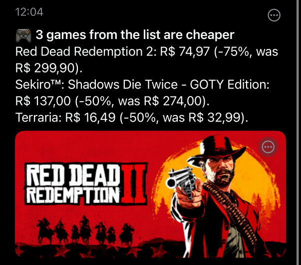
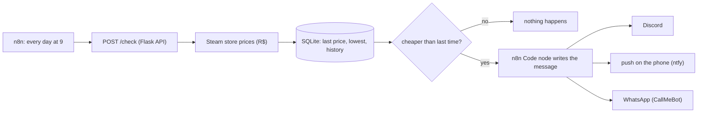

# price-watch-n8n

Tells me when a game I want on Steam goes on sale: on Discord, as a push notification on my phone or on WhatsApp.

Every morning [n8n](https://n8n.io) asks a small Python API for the prices of the games on my list. The API reads them from the Steam store (in R$), compares them with what it saw before and answers with the deals: games that got cheaper, the discount, and whether it's the lowest price since it started watching. n8n writes the message and sends it wherever I set it up.



The push above is real: the `real run` workflow in Actions runs it against the live Steam store and sends the deals to the channels saved as repo secrets.


## Why I built it

I wanted to try n8n for real instead of just watching videos about it, and "tell me when this game is cheaper" is something I actually check by hand during every Steam sale. Splitting it this way also felt right: the price logic lives in code with tests, and n8n only handles the schedule and the notifications, which is the part that changes the most.

## How it works



- The games are in [`watchlist.json`](watchlist.json) (Elden Ring, Hollow Knight: Silksong, Baldur's Gate 3, RDR2...). Any Steam game works, the id is the number in the store url. n8n can also send its own list: `{"appids": [1245620, 1030300]}`.
- `POST /check` gets every price in one call to the store's public `appdetails` endpoint (no key needed) and returns the deals, biggest discount first.
- A game already on sale the first time it's seen is a deal. A sale that just goes on is not news again the next day, otherwise the same Terraria message would show up for two weeks.
- "Lowest" means the lowest since the API started watching that game, not the lowest ever on Steam.
- `GET /games` lists what it's watching with the current and lowest price, `GET /history?appid=...` every price a game had.

The Code node turns the deals into three messages: Discord cards with the game's banner, a short push that opens the store page when tapped, and plain text for WhatsApp.


## Running it

You need Docker.

```bash
cp .env.example .env   # fill in the channels you want, see below
docker compose up -d --build
docker compose exec n8n n8n import:workflow --input=/workflows/price-watch.json
```

Then open http://localhost:5678, open "Steam deals watch" and click "Test workflow". To leave it running every day, turn the workflow on (the "Active" toggle).

Where the deals go (each one is used only if it's filled in `.env`):

| Channel | What to set | How |
| --- | --- | --- |
| Discord | `DISCORD_WEBHOOK_URL` | Channel settings > Integrations > Webhooks > copy the url |
| Phone push | `NTFY_TOPIC` | Install the [ntfy](https://ntfy.sh) app and subscribe to a topic name only you know. No account needed |
| WhatsApp | `WHATSAPP_PHONE`, `WHATSAPP_APIKEY` | [CallMeBot](https://www.callmebot.com/blog/free-api-whatsapp-messages/): send it the activation message once and it answers with your key. Free, for personal use |

Waiting for a real sale to test it takes days, so this makes a few games look pricier "yesterday", and the next run reports them:

```bash
docker compose exec api python -m price_watch.demo 4
```

### Just the API, without Docker

```bash
python -m venv .venv
.venv/Scripts/activate        # or source .venv/bin/activate
pip install -r requirements-dev.txt
pytest
flask --app price_watch.api run --port 8000
```

## Notes

- Webhook urls, the ntfy topic and the WhatsApp key are read from env vars (`$env.DISCORD_WEBHOOK_URL` and friends), so none of them ends up inside the exported workflow json. That needs `N8N_BLOCK_ENV_ACCESS_IN_NODE=false`, which is set in the compose file. Each sender sits behind an IF node that checks its setting, so the channels you don't use are just skipped.
- Tests run offline: the Steam client is tested against real answers from the store saved in `tests/fixtures` (including the odd ones: a free game comes back with an empty list instead of an object), and the JavaScript from the n8n Code node is pulled out of the workflow json and run with Node, so a typo there fails CI instead of failing at 9am.
- CI also runs the whole thing end to end (`ci/e2e.sh`): docker compose brings up the api, n8n and `ci/fakes.py`, a tiny server pretending to be the Steam store, Discord, ntfy and CallMeBot. It imports the workflow and runs it three times with `n8n execute`: the games already on sale have to reach all three channels, the same prices again must send nothing, and after the demo script fakes older prices the drops have to go out.
- The screenshots above come from the same setup: `ci/shots` opens the editor with Playwright, clicks "Test workflow" and saves the pictures (the `screenshots` workflow in Actions, run by hand).
- I started with FastAPI but Windows Smart App Control blocks the pydantic-core dll on my PC, so I went with Flask, which is plenty for four routes.
- SQLite instead of Postgres because it's one table of games and one of history for one person. All the SQL is in `price_watch/store.py`, so swapping is easy.
- The first version watched book prices on [books.toscrape.com](https://books.toscrape.com), a site made for scraping practice. It worked, but its prices never change, so it never had anything to say. Steam actually has sales.
