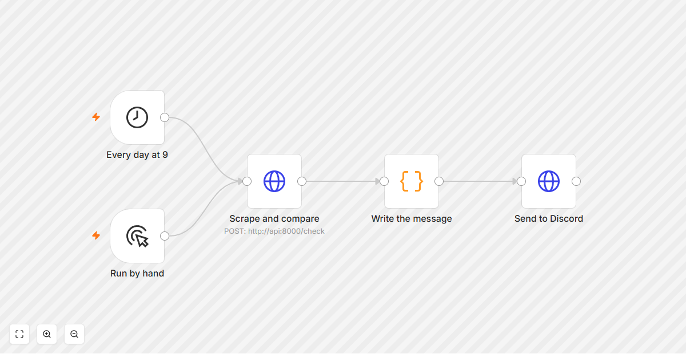
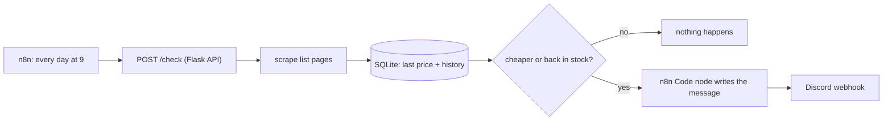
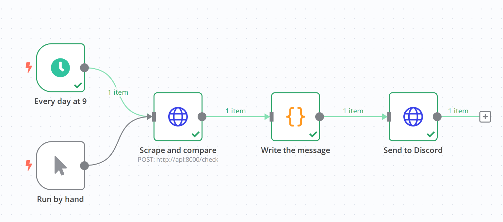
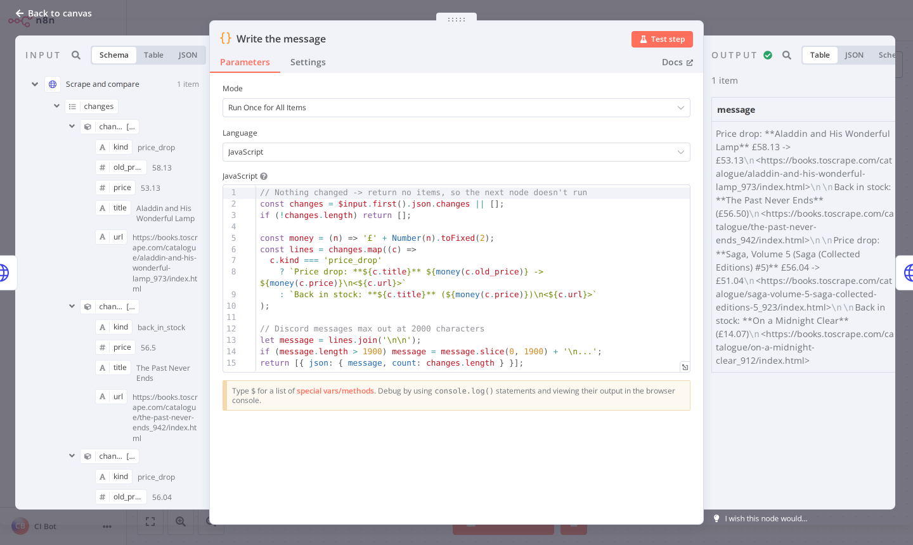
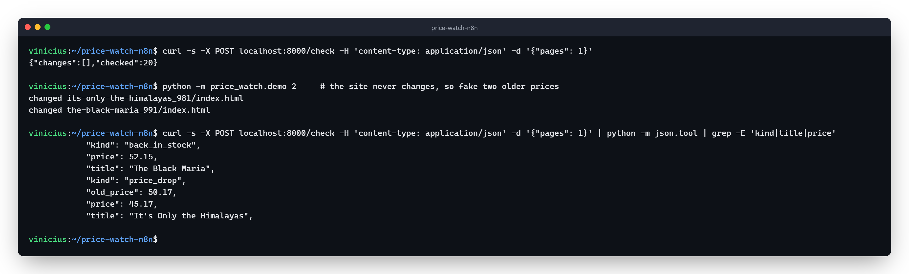
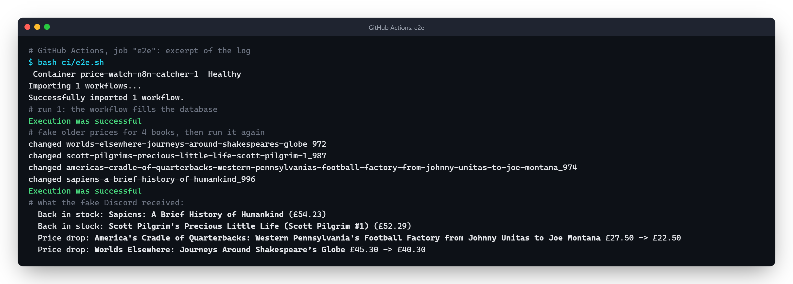

# price-watch-n8n

A small automation that keeps an eye on book prices and tells me on Discord when something gets cheaper or comes back in stock.

The scraping part is Python (requests + BeautifulSoup, same idea as my [webscraper-python](https://github.com/ViniciuscLemos/webscraper-python)), wrapped in a tiny Flask API. [n8n](https://n8n.io) does the "automation" part: it calls the API every morning, and if there's news it writes a message and posts it to a Discord webhook.

The books come from [books.toscrape.com](https://books.toscrape.com), a site made for people to practice scraping, so I'm not hammering a real store.



## Why I built it

I wanted to try n8n for real instead of just watching videos about it, and price alerts are the classic "I'd actually use this" automation. Splitting it this way also felt right: the scraping logic lives in code with tests, and n8n only handles the schedule and the notification, which is the part that changes the most (Discord today, email or Telegram tomorrow, just swap the last node).

## How it works



- `POST /check` scrapes `pages` list pages (default 3, max 50), saves each book in SQLite and returns only the changes. A book seen for the first time isn't a change, otherwise the first run would send 100 messages.
- `GET /history?url=...` returns every price a book had.
- The API only accepts books.toscrape.com urls, since n8n can send anything to it.

Here's a real run in the n8n editor (taken in CI by `ci/shots`): every node went green and the message went out.



The Code node turns the API's changes into one Discord message:



Trying the API by hand: the first check only fills the database, then two books get older prices and the next check reports them.



## Running it

You need Docker.

```bash
cp .env.example .env   # paste your Discord webhook url in it
docker compose up -d --build
docker compose exec n8n n8n import:workflow --input=/workflows/price-watch.json
```

Then open http://localhost:5678, open "Price watch (books.toscrape.com)" and click "Test workflow". The first run only fills the database.

The site never changes its prices (it's static), so to see an alert I fake a few old prices and run it again:

```bash
docker compose exec api python -m price_watch.demo 4
```

To leave it running every day, turn the workflow on (the "Active" toggle).

### Just the API, without Docker

```bash
python -m venv .venv
.venv/Scripts/activate        # or source .venv/bin/activate
pip install -r requirements-dev.txt
pytest
flask --app price_watch.api run --port 8000
```

## Notes

- The webhook url is read from an env var (`$env.DISCORD_WEBHOOK_URL`) so it never ends up inside the exported workflow json. That needs `N8N_BLOCK_ENV_ACCESS_IN_NODE=false`, which is set in the compose file.
- Tests run offline: the scraper is tested against trimmed copies of the site's html in `tests/fixtures`, and the JavaScript from the n8n Code node is pulled out of the workflow json and run with Node, so a typo there fails CI instead of failing at 9am.
- CI also runs the whole thing end to end (`ci/e2e.sh`): docker compose brings up the api, n8n and a tiny server pretending to be Discord, imports the workflow and runs it twice with `n8n execute`. The first run only fills the database; then the demo script fakes older prices and the second run has to post a "Price drop" message.


- I started with FastAPI but Windows Smart App Control blocks the pydantic-core dll on my PC, so I went with Flask, which is plenty for three routes.
- SQLite instead of Postgres because it's one table of history for one person. If this grows, swapping is easy because all the SQL is in `price_watch/store.py`.
